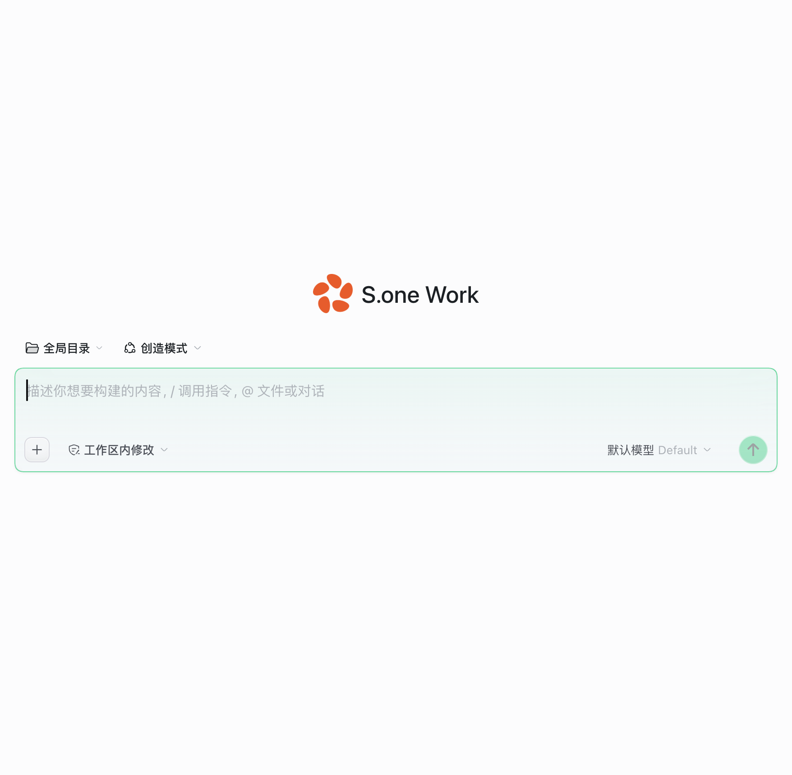
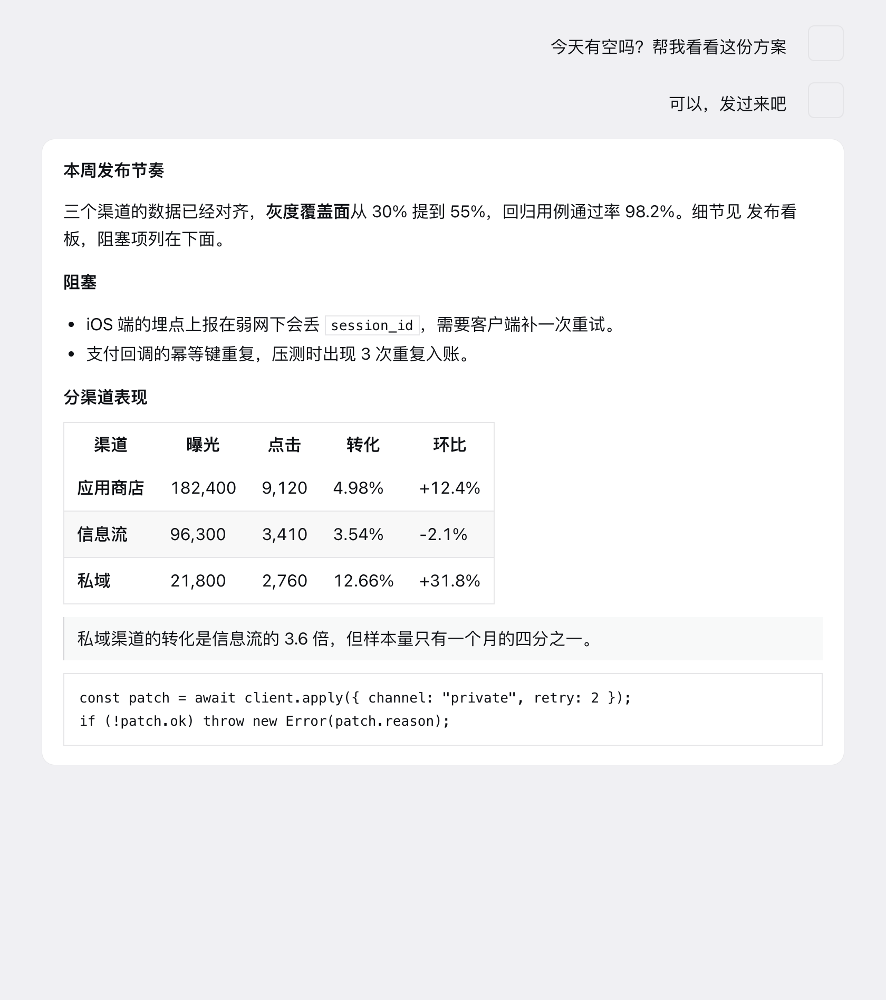
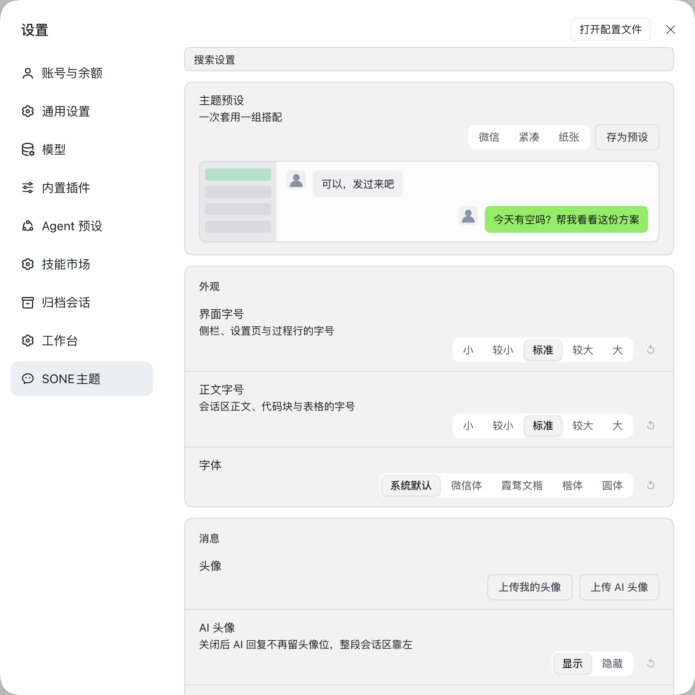

# Sone-wx

DeepSeek Harness 插件：**微信风格皮肤 + 品牌自定义**，设置里独立「SONE主题」分区（不再占用通用页）。

## 预览

| 新会话页 | 会话内容样式 |
| --- | --- |
|  |  |



由三个本地插件合并而来（2026-11-08）：

- `dsh-wechat-skin`（移植自 licheng-ma/dsh-wechat-skin v1.0.0，本地已深度定制，逐版变更见下方更新记录）：绿色气泡、会话/消息头像、界面与正文两级字号、列表密度、对话宽度、侧边栏背景色、侧边栏入口排序、主题预设、输入框美化、设置页实时预览、适配自检、配置导出导入、输入框随内容自动增高、AI 头像开关（关闭后会话区左对齐）、我的头像开关（关闭后发送气泡贴右）、运行状态点圈、字体族/高对比度/头像形状、行高、减少动效、输入框效果（毛玻璃/发送形变/光标）、选中色与滚动条、深浅两套配色、对比度与交互收口。localStorage 键保持 `dsh-wechat-skin:*`，老数据直接延续。
- `dsh-brand-studio`：品牌标志/标题/文字标志图片，接管侧栏与新会话页品牌位。
- `dsh-table-stabilizer`：宽表格悬停跳动修复（把 `--dsh-scrollbar-width` 绑到表格容器，实测滚动条高度），纯 client 行为，无设置项。数据从 `~/.dsh/dsh-brand-studio/brand/` 首次启动自动迁移到 `~/.dsh/sone-wx/brand/`，接口 `/sone-wx/brand`。

## 安装

插件目录必须放在 `$DSH_HOME`（默认 `~/.dsh`）**之外**——官方插件开发文档明确规定「Do not create packages under $DSH_HOME」。推荐位置：`~/projects/sone-wx`。

```bash
git clone https://github.com/kapibalawang-max/sone-wx ~/projects/sone-wx
```

两种官方安装入口，任选其一：

1. **设置界面**：DSH 设置 → **Plugins > Add plugin**，选择插件目录（含 `package.json` 的那一层，例如 `~/projects/sone-wx`）。
2. **工具调用**：让 agent 调用 `plugin_manager` 工具，`action=install_bundle`、`target=<插件目录绝对路径>`（例如 `/Users/you/projects/sone-wx`）。

安装后：

- 在设置的 Plugins 列表里**启用** sone-wx。启用后设置页出现独立的「SONE主题」分区；皮肤本身恒启用，分区内没有总开关。
- 改动 `client.js`（客户端半）后**刷新页面**即可生效。
- 改动 `index.js`（宿主半）后需要**重启 DSH**。

## 使用说明

入口：DSH 设置 → **SONE主题**（独立分区，不占用通用页）。分区内是皮肤卡与品牌卡：顶部有「搜索设置」输入框按名称过滤设置项，底部有适配自检状态、版本号，以及「导出配置 / 导入配置 / 分享当前设置 / 恢复默认」。

### 17 项设置

皮肤卡共 17 项设置：主题预设单独在顶部（下方带实时预览），其余分外观、消息、布局、辅助四组。

| 分组 | 设置项 | 可选值 | 默认 |
| --- | --- | --- | --- |
| 顶部 | 主题预设 | 微信 / 紧凑 / 纸张 / 自定义预设 | 微信 |
| 外观 | 界面字号 | 小 / 较小 / 标准 / 较大 / 大 | 标准 |
| 外观 | 正文字号 | 小 / 较小 / 标准 / 较大 / 大 | 标准 |
| 外观 | 字体 | 系统默认 / 微信体 / 霞鹜文楷 / 楷体 / 圆体 | 系统默认 |
| 消息 | 头像 | 上传我的头像 / 上传 AI 头像 | 内置剪影 |
| 消息 | AI 头像 | 显示 / 隐藏 | 显示 |
| 消息 | 我的头像 | 显示 / 隐藏 | 显示 |
| 消息 | 头像形状 | 圆角方形 / 正圆 / 方形 | 圆角方形 |
| 消息 | 头像图案 | 剪影 / 首字 | 剪影 |
| 消息 | 列表密度 | 标准 / 紧凑 | 标准 |
| 布局 | 对话宽度 | 全宽 / 适中 / 官方 | 全宽 |
| 布局 | 侧边栏背景色 | 5 个预设色板 + 自定义取色器 | 微信灰 |
| 布局 | 行高 | 紧凑 / 标准 / 舒展 | 标准 |
| 布局 | 右侧面板默认展开 | 开启 / 关闭 | 关闭 |
| 辅助 | 减少动效 | 完整 / 减少 | 完整 |
| 辅助 | 高对比度 | 标准 / 高对比 | 标准 |
| 辅助 | 输入框效果 | 开启 / 关闭 | 开启 |

- **界面字号**作用于侧栏、设置页与过程行；**正文字号**作用于会话区正文、代码块与表格，两级互不影响。
- **AI 头像**隐藏后 AI 回复不再留头像位，整段会话区靠左；**我的头像**隐藏后不显示你发送的会话头像，气泡贴右。
- **头像图案**的剪影按会话标题哈希取色相与姿态；未上传图片时用它兜底。
- **侧边栏背景色**选自定义色时，文字按底色亮度自动切换深浅。
- **右侧面板默认展开**只在切换会话时把收起的右栏打开；同一会话内手动收起后不会被强行弹回。右栏默认宽度为视口 35%，一旦你拖过右栏手柄就永远尊重你拖出的宽度。
- **减少动效**关闭皮肤的过渡与动画，跟随系统辅助功能设置；**高对比度**加深正文、次要文字与边框；**输入框效果**是毛玻璃卡片、光标滑动、发送时气泡从输入框落下。
- 每项右侧都有「重置这一项」。主题预设可「存为预设」，自定义预设可删除（二次确认）。

### 品牌

品牌卡提供标志图片、标题、文字标志图片与新会话标语，接管侧栏与新会话页的品牌位。标语直接替换新会话页的标题文字，清空即恢复官方默认。

### 数据存在哪里

| 数据 | 位置 |
| --- | --- |
| 皮肤设置、上传的头像、自定义预设、侧栏入口排序、会话星标 | 浏览器 localStorage，键前缀 `dsh-wechat-skin:*` |
| 品牌文字与开关 | `~/.dsh/sone-wx/brand/state.json` |
| 品牌标志与文字标志图片 | `~/.dsh/sone-wx/brand/mark.*`、`~/.dsh/sone-wx/brand/wordmark.*` |
| 崩溃诊断 | `~/.dsh/sone-wx/diag.json` |

常用键（均带 `dsh-wechat-skin:` 前缀）：`font-level`、`text-font-level`、`density`、`chat-width`、`sidebar-bg`、`preset`、`presets`、`line-height`、`reduced-motion`、`font-family`、`contrast`、`avatar-shape`、`avatar-style`、`composer-fx`、`rightbar-auto`、`user-avatar`、`ai-avatar`、`sidebar-order`、`starred`。键名沿用上游 dsh-wechat-skin，老数据直接延续。

品牌数据首次启动时从旧插件目录 `~/.dsh/dsh-brand-studio/brand/` 自动迁移到 `~/.dsh/sone-wx/brand/`。

### 分享码

设置卡底部的「分享当前设置」生成一段以 `SWX1.` 开头的分享码，复制发给对方；对方在同一位置打开「粘贴分享码」，粘贴后点「导入」即套用同一套外观。弹层按 **Esc** 关闭。

- **入码**：主题预设、界面与正文字号、行高、列表密度、对话宽度、侧边栏背景色、字体、高对比度、头像开关与形状与图案、输入框效果、右栏自动展开、自定义预设。
- **不入码**：上传的头像图片、侧边栏入口排序、会话星标、右栏拖动记录、品牌数据。
- 空码、坏码与超长码（超过 64KB）明确报「分享码无效」；导入只接受白名单内的键，伪造键会被剔除。

### 会话星标

会话行悬停时右侧出现星形按钮，点击切换星标；已星标的行显示琥珀金（Radix amber9）星形与行高亮。

- **只做行内标记，不改变会话顺序。** 早期版本曾用 CSS `order` 把星标会话在分组内视觉置顶，该重排已移除——它会让宿主自己的拖拽排序静默错位。
- 星标存本地 `dsh-wechat-skin:starred`（上限 500 条），不写宿主数据、不跨设备同步。
- 「恢复默认」会一并清除星标记录。

### 导出、导入与恢复默认

- **导出配置**下载 `sone-wx-config.json`，范围比分享码更大：含全部皮肤设置、上传的头像图片与侧栏入口排序。品牌图片由品牌卡单独导出。
- **导入配置**选择该 JSON 文件，校验后应用。
- **恢复默认**需二次确认（再点一次生效），清除全部皮肤设置，含上传的头像、自定义预设、侧栏入口排序、会话星标与右栏拖动记录，不可撤销。品牌数据不受影响，品牌卡另有「恢复默认品牌」（同样二次确认，4 秒内自动撤销）。

### 适配自检

卡片底部的状态点报告皮肤与当前 DSH 版本的适配情况：「适配正常」「选择器缺失 (n)」「上下文探针未渲染」。DSH 升级后宿主哈希类名可能漂移，自检报缺失时需按当前 `*.module.css` 重新映射（见「结构」）。

### 停用与卸载

停用或卸载会移除全部注入内容：皮肤与 UI 的 `<style>` 标签、body 上的类与 `data-*` 标记、DOM 增强节点（星形按钮、头像、分组计数、输入框效果）、侧栏入口的 `order`、注入的 CSS 变量，并退订所有监听、还原被接管的 `console.error`、停止 `/sone-wx/diag` 上报。

**不会删除数据**：localStorage 里的 `dsh-wechat-skin:*` 与 `~/.dsh/sone-wx/` 下的品牌、诊断文件都保留，重新启用后设置延续。要彻底清除，需手动删除这些 localStorage 键与 `~/.dsh/sone-wx/` 目录。

## 结构

- `index.js` — Host 半：品牌数据真源 + webServer 路由（含一次性迁移）。
- `client.js` — Client 半：皮肤（含全部样式与行为）+ 品牌编辑器，合并注册一个 `settings.section`。
- 维护铁律沿用 dsh-wechat-skin：DSH 升级后哈希类名可能漂移，需按当前 `*.module.css` 重新映射；样式改 `client.js` 内 WECHAT_CSS（本插件无独立 src，双源合并为单源）。

## 更新记录
### v1.46.1

收尾三件事。

- **输入框玻璃让位给 dsh-chat-ux**：两者都接管 `[data-composer-card]` 时，皮肤那层绿色渐变会叠在 chat-ux 的中性淡出带上，输入框上方出现一条绿色阴影。现在皮肤规则加 `:not([data-chat-ux-composer-glass])`：装了 chat-ux 并开启它的毛玻璃时由它接管玻璃，皮肤只保留光标与发送形变这些行为层。
- **插件元数据本地化**：新增 `locale/zh.json` 与 `locale/en.json`（`meta.title` / `meta.description`），`exports` 与 `files` 同步放开 `./locale/*.json`。此前 Plugins 列表里只能显示裸包名 `sone-wx`。
- **视觉回归去掉 Python 依赖**：`test/visual.mjs` 原先靠 `python3` + Pillow 比对像素，现在是纯 Node（新增 `test/png.mjs`，自带 PNG 解码与差值）。新增 `test/png-test.mjs` 4 项钉住「pct 是百分比而非比例」这个单位——这个单位写错会让 0.15% 的阈值松 100 倍，真实 15% 漂移照样通过。

### v1.46.0

全面审查（功能实测 / 样式主题 / 公开仓库合规三路审计）后的集中修复。

**会话星标：移除重排，修好点击**

- 移除「星标会话在分组内置顶」。宿主拖拽按视觉矩形判落点、按数据序写回，CSS `order` 重排会让拖拽静默错位；`order:-1` 还会把星标行排到分组标题之上。星标现在只做行内标记，不改变会话顺序。
- 修复星标按钮盖住宿主「置顶会话」按钮：实测两者矩形重叠 227px²，`elementFromPoint` 命中的是星标，置顶按钮点不动。现在宿主动作簇整体左移 26px 让位，星标行的时间戳同样让位。
- 星标颜色改为四主题令牌 `--wc-star-ink`：浅色 `#ab6400`（3.77:1）、深色 `#ffc53d`（11.15:1）、纸张浅 `#8a6100`（4.52:1）、纸张深 `#ffc53d`（11.34:1）。原先固定 `#ffc53d` 在浅色侧栏上只有 1.29:1。
- 按钮补本地化 `aria-label`（跟随界面语言）与实时 `aria-pressed`，补 `:focus-visible` 描边；停用皮肤时移除注入的按钮与标记，而不只是摘监听器；星标记录去重、过滤非法项并上限 500 条。

**分享弹层**

- 修复 Esc 把整个设置页一起关掉：改为捕获阶段监听并 `stopPropagation`，只关弹层。
- 打开时焦点移入弹层、Tab 在弹层内循环、背景滚动锁定，关闭后焦点与滚动状态还原。
- 导入失败与复制失败的提示改为显示在弹层内（`role="alert"`），不再写进被遮罩挡住的状态条；复制降级路径读取 `execCommand` 真实返回值，失败如实报错，临时 textarea 移到屏幕外。
- 弹层补 `role="dialog"` / `aria-modal` / `aria-label`，可用时通过 portal 挂到 body。
- 分享码解码加 64KB 上限，UTF-8 解码改严格模式（非法字节直接拒绝，不再静默替换）。

**新会话标语**

- 官方标题从 `font-size:0` 改为 `display:none`：原写法把官方标题留在无障碍树与复制内容里，读屏会念两遍、选中复制拿到的是官方原文。标语改由标题组 `::before` 承载。
- 标语字号令牌化为 `--wc-hero-size`，跟随界面字号档缩放，不再是第五个固定字号。

**右栏与主题**

- 右栏「已手动拖动」标记从 localStorage 改为 sessionStorage：宿主本身不持久化右栏宽度，永久标记会让 35% 默认在新窗口永远失效且无法恢复。现在每个新窗口重新应用默认，「恢复默认」也会清除该标记（并清掉旧版遗留的永久标记）。
- 「右侧面板默认展开」修复：偏好检查移到记录会话之前，已在某个会话里时打开开关也能立即生效。
- 纸张主题补 `--wc-accent-bright`（浅 `#6b8f45` / 深 `#9dbf6e`）：此前纸张只覆盖了 solid/press，选中色、焦点环、勾选框、代码底色等仍在用冷调微信绿。置顶行洗色在纸张下改用本地 moss 色调。
- 输入框聚焦环、模型选择器深色态、设置页焦点环与搜索高亮的硬编码绿色全部改走主题令牌。
- 弹层改用皮肤自己的表面色阶（深色 `--wc-surface-dark`，纸张深色取暖炭），不再落在宿主冷灰上。
- 定时会话徽标色、链接与滚动条圆角、脉冲动效时长（.15s → 250ms）令牌化；脉动光晕改用告警色本身而非第二个琥珀；删除宿主本版不存在的 `_file_` 死选择器。
- 「输入框效果」单项重置修正为恢复真实默认（开启），此前会重置成关闭。

**公开仓库合规**

- 新增 LICENSE（MIT）与 NOTICE：本插件是 licheng-ma/dsh-wechat-skin (MIT) 的衍生作品，此前声明 MIT 却未附许可与上游署名。
- 恢复被网页端编辑截断的更新记录（37 行 → 400+ 行），保留新增的预览截图段。
- 新增安装章节（官方 Plugins > Add plugin 入口，插件目录须放在 `$DSH_HOME` 之外）与使用说明（17 项设置、数据落盘位置、分享码、星标、卸载行为）。
- 修正 README 中与代码不符的计数与「不联网」表述：只与本机宿主同源通信（`/sone-wx/brand`、`/sone-wx/diag`），不访问外部网络。
- `package.json` 补 repository / homepage / bugs / keywords / author，files 加入 docs 与许可文件（否则打包安装后预览图断链）；新增 .gitignore。

**测试**

- 新增 `test/share-modal-test.mjs`（8 组：Esc 隔离、焦点进出与 Tab 循环、错误可见性、剪贴板诚实性、解码上限），套件总数 43。
- `test/star-test.mjs` 重写为 10 组，把「不得用 CSS 重排」「动作簇必须让位」「四主题星标色」「停用清理注入节点」钉成守卫。
- `test/rightbar-width-test.mjs` 扩到 10 组，覆盖 per-window 语义、旧标记迁移与重置后立即重应用。
- 测试去本机化：2 处硬编码仓库绝对路径改 `import.meta.url` 相对定位，10 个文件硬编码 Chrome 路径统一走 `test/browser.mjs`；fixture 里的真实业务数据换成示例数据。断言语义逐行比对未变。
- `run-all` 摘要改读 node:test 的 pass/fail 计数，绿色套件不再只显示一行耗时。

### v1.45.2

- 调整：移除会话区思考模块（reasoning）的背景色药丸——浅色 `rgba(0,0,0,.035)`、深色 `rgba(255,255,255,.06)` 的底色与配套内边距、圆角全部去掉，思考内容回归画布上的普通文字，仅保留字号随全局字阶缩放。

### v1.45.1

- 修复：设置页「SONE主题 渲染出错」（ReferenceError: useState/useEffect is not defined）。v1.43.0 在 WechatSkinRow 内新增分享码状态与 Esc 关闭逻辑时误用了裸 `useState`/`useEffect`，而该组件作用域内未引入这两个 Hook（其余代码均为 `(0, _react.useState)` 形式），React 渲染即抛错、被错误边界接管。现改为与组件内其他 Hook 一致的 `(0, _react.useState)`/`(0, _react.useEffect)` 写法。
- 验证：真实设置页（自签 cookie + headless Chrome）确认外观/消息/布局/辅助四组与 17 项设置完整渲染、无渲染出错；43 套测试全绿。


- 2026-11-12 v1.45.0 右侧面板默认宽度改为视口的 35%（宿主默认 45%）。仅在你从未拖动过右栏拖拽手柄时生效（本地记录 dsh-wechat-skin:rightbar-touched）；一旦手动拖过，永远尊重你拖出的宽度。窗口缩放时未拖动过则保持 35% 比例。新增 test/rightbar-width-test.mjs（8 组：比例计算、touched 跳过、小窗口下限、服务延迟重试、拖动标记、resize 跟随、监听清理、接线守卫），测试套件 43 项。
- 2026-11-12 v1.44.0 会话星标：会话行悬停出现星形按钮，点击给该会话打星标（纯视觉层，星标存本地 dsh-wechat-skin:starred，不改宿主数据）。激活色为琥珀金（Radix amber9），「恢复默认」会同时清除星标记录。新增 test/star-test.mjs（5 组：星标标记、按钮复用、点击处理、接线守卫），测试套件 42 项。**后续版本已移除「分组内视觉置顶」**：CSS `order` 重排会让宿主自己的拖拽排序静默错位，星标现在只做行内标记（星形按钮 + 行高亮），不改变会话顺序。
- 2026-11-12 v1.43.0 预设分享码：设置卡新增「分享当前设置」——当前外观（预设、字号/正文字号、行高、密度、对话宽度、侧栏背景色、字体、对比度、头像开关/形状/图案、输入框效果、右栏自动展开与自定义预设）编码为 `SWX1.` 开头的可复制分享码；头像图片与侧栏会话排序等个人数据不入码。对方在设置页粘贴分享码即可一键应用同一套外观（复用既有 importConfig 校验白名单，空码/坏码明确报错，Esc 关闭弹层）。新增 test/share-code-test.mjs（16 组：编码回环 / URL 安全 / 排除项 / 非法码拒绝 / 伪造键剔除 / 接线守卫）。
- 2026-11-12 v1.42.0 四路复审（功能链路 / 样式主题 / 设置页 UI / 代码增量）修复：①样式——删除 24 条被宿主 ThemePresenter 内联令牌恒定压制的 `--dsw-alias-*` / `--dsw-specific-bubble` 死声明（纸张深色的暖色意图改由 JS 侧 TOKEN_OVERRIDES 单源表达），`--wc-caret-ink` 深色覆盖改走令牌，`--wc-md-gap` 声明提升到 assistant-step 作用域（blockquote/pre/tableScroll 的外层引用不再退化为 0），删除 4 条冗余规则，`.dsh-wc-reset`/`.dsh-wc-group` 裸值令牌化；②设置页预览保真——预览消费 字号档/列表密度/头像图案/预设，色值与 WECHAT_CSS 色阶对齐（侧栏 #e8e8ec、画布 #fcfcfd、深色气泡 #2e3135、纸张气泡 #ded3ba 等），点阵与剪影头像样式进预览，深浅色跟随 theme/change 实时刷新；③交互——品牌「恢复默认品牌」改为二次确认（再点一次生效，4 秒自动撤销），设置页搜索覆盖品牌卡，确认计时器在卸载时清理；④文案——resetHint 如实说明清除范围（含上传头像与自定义预设），rightbarAutoHint 与实际行为一致，预览对话语义修正（AI 气泡说 AI 的话），品牌 resetHint 补「标语」，fontTitle 英文对齐，删除从未渲染的品牌 intro 与死键 sidebarBgReset；⑤工程——5 个测试文件去除本机绝对路径（改 import.meta.url 相对定位），README 更新记录恢复时间序。
- 2026-11-12 v1.41.4 修复右侧栏拖拽手柄命中问题：宿主全局浮层层（z-index 20、inset:0）会盖住 z-index 11 的拖拽手柄，导致鼠标生效位置不对；皮肤把手柄提到 z-index 21，并把命中带从 8px 加宽到 12px（仍以可见分界线为中心）。
- 2026-11-12 v1.41.3 全面体检（client.js + 宿主路由/测试两路审计 39 条）：修复主题切换监听器不退订、品牌导出/导入丢新会话标语（heroTagline）、4 处品牌加载裸 Promise、设置页自检数组缺 key、resetSkin 漏清旧头像键、探针选择器不匹配时仍渲染皮肤设置区、slots 注入无守卫、body 类锁存后重复探测、深色代码光标色 --wc-caret-ink 缺深色/纸张定义、删除死令牌 --wc-green-hover；测试侧删除测已删功能的 bg-test（读陈旧 /tmp 快照）、panel-order-test 改从 client.js 现行 region 取代码并补失败退出码；宿主 index.js 的 diag 写入并入状态锁、删除 fenceRefused 死分支；package.json 兼容声明补 0.2.2-rc.2、engines.node 提到 >=20.11（代码用 import.meta.dirname）；contrast-test 深色/纸张用例改从对应主题块解析令牌，宿主深色面钉真实宿主令牌值。darkSkin 不进 store、composerFadeBound 陈旧条目、表格 resize 防抖等低价值项经评估不修。
- 2026-11-12 v1.41.2 按用户要求去掉右侧栏展开时左侧的 0.5px 分隔竖线（`border-left` 已从右栏面板规则中移除，仅保留展开态背景）。
- 2026-11-12 v1.41.1 修正 v1.41.0 的「右侧面板默认展开」不生效：宿主在进入会话时就会立刻写入该会话的右侧栏保存布局（`dsh.sidebar-right.v1.<sessionId>`），「无保存布局才自动打开」的判断永远不成立。改为直接语义——开关打开时，每次切换会话若右侧栏处于收起状态就自动展开（toggleExpanded 在会话面板尚未挂载时会抛错，带 300ms × 6 次重试）；在同一会话内手动收起后不会被强行弹回。
- 2026-11-12 v1.41.0 右侧面板默认展开（新设置）：官方没有「所有会话默认打开右侧栏」的设置——展开状态按会话存 localStorage `dsh.sidebar-right.v1.<sessionId>`，新会话初始收起，布局服务（`ctx.sidebarRight`）只暴露 isExpanded/toggleExpanded。新增「右侧面板默认展开」开关（设置页布局组，默认关）。数据键 `dsh-wechat-skin:rightbar-auto` 纳入导出/导入/恢复默认；新增 `test/rightbar-auto-test.mjs`，设置行单项重置计数 15。
- 2026-11-12 v1.40.4 修复新会话页品牌图与标语的垂直对齐：宿主标题 span 的行盒行高大于标语行高，基线对齐使标语字形相对 logo 偏上；标题 span 改为 flex 容器并 align-items:center，标语与品牌图中心线严格对齐。
- 2026-11-12 v1.40.3 新会话页 hero 区不再显示「预览版」徽章（用户要求）：WECHAT_CSS 对 hero headline 内的 `_previewBadge` 施加 display:none，不影响其他区域的徽章类元素。
- 2026-11-12 v1.40.2 新会话标语改为直接替换 hero 标题文字（此前 v1.40.1 是标题下方另起一行，与预期不符）：官方标题 span 以 CSS font-size:0 隐藏，标语经其 ::after 以原标题字号（26px/500/--wc-ink-1）在原位置渲染；取值与开关仍在 body（--dsh-wc-hero-tagline + data-dsh-wc-tagline-set），React 重渲染零干预，清空恢复官方默认。真实页面探针验证设值/打字重渲染/清空三态，brand-tagline-test 更新为替换语义。
- 2026-11-12 v1.40.1 修复新会话页「标题和标语重叠」：v1.40.0 把标语写进宿主标题 span 的 `textContent`，React 重渲染会按虚拟 DOM 恢复标题文本，两条文案在 hero 区叠写。改为把标语存到 hero stack 的 `data-dsh-wc-hero-tagline` 属性，由 WECHAT_CSS 的 `[data-dsh-wc-hero-tagline]::after` 渲染成标题下方独立小字（`--wc-fs-sm`、`--wc-ink-2`、居中、`max-width: min(640px, 82%)`、可换行），不再插入或改写任何 React 管辖节点；宿主标题保持官方原文，清空即移除属性。brand-tagline-test 重写为属性语义（12 项），CSS 快照更新。

- 2026-11-12 v1.40.0 新会话标语可自定义：品牌卡新增「新会话标语」输入行（40 字上限，Enter/失焦保存、Esc 还原，留空回到官方默认「探索未至之境」）。宿主 HeroShell 的标语没有 slot，只有 DOM 文本，改法是定位 `_8tPydW_titleGroup` 里第一个无类名 span 写 `textContent`，官方原文先存 `dataset.dsh-wc-hero-default`，清空时原样还原；「预览版」徽标（带类名的第二个 span）不受影响。React 重挂载由 body 级 MutationObserver（rAF 合并）跟进，停用皮肤即还原。数据走 `/sone-wx/brand` 的 `heroTagline` 字段（index.js 读时截断 40 字、写时 trim+截断）。新增 `test/brand-tagline-test.mjs`（8 项行为 + 接线守卫），套件总数 39。随 DSH 0.2.2-rc.2 顺带重映射两个漂移类名：`._markdown_rve47_5→._markdown_13jw0_5`、`._toast_hr9yd_6→._toast_af3m1_6`（host-hash-test 恢复 96/96）。

- 2026-11-12 v1.39.3 分组计数阈值：少于 2 个会话不显示徽标（单数字没有信息量），超过 99 显示「99+」，计数本身仍精确。group-count-test 增两条边界断言（20 项）。

- 2026-11-12 v1.39.2 分组计数徽标加圆形底：数字改为 18px 胶囊（单数字即圆），底色走新令牌 `--wc-count-bg/--wc-count-ink`，四套主题各配一对——浅 #f9f9fb 底 + #4a4e56 字（7.94:1）、深 #2a2d31 底 + #c3c8ce 字（8.22:1）、纸浅 #fbfaf8 + #4c4c47（8.28:1）、纸深 #2a2620 + #b9b3a8（7.22:1），全部 ≥4.5:1 且比所在侧栏底亮/暗一档。胶囊高度等于标题 18px 行框，`vertical-align:top` 光学居中不挤基线。contrast-test 增 4 组断言，group-count-test 增胶囊形状与令牌守卫（18 项）。

- 2026-11-12 v1.39.1 修「数字不在分组标题同一行」：徽标原本挂在 `.JoiKIa_projectText` 上，而宿主这个容器是 `display:flex; flex-direction:column`（为「标题 + 路径」两行准备），所以 `::after` 被排成第三行、掉到标题下方。改为挂在叶子节点 `.JoiKIa_title` 上，实测行高仍是 32px、标题块 16px 单行。测试补两条守卫：徽标规则必须落在 title、且不留 projectText 版本；桩 DOM 改成按真实查询串 `.JoiKIa_projectText .JoiKIa_title` 命中。

- 2026-11-12 v1.39.0 分组会话计数：分组标题后显示该分组下的会话数（空组与无会话分组不显示）。计数不数 DOM，而是读宿主自己的 `workspaces`/`sessions` 快照 store，按官方侧栏同一条推导规则计算——子会话隐藏、空白会话只算当前正在看的那一条、归档会话跟随官方「归档筛选」（默认隐藏 / 全显 / 仅归档，从官方视图 store 镜像读取）；不属于任何分组的可见会话计入「未分组」。数据变化由两个 store 的订阅实时刷新，徽标通过 React 安全的 `data-dsh-wc-count` 属性写入分组标签、CSS `::after` 渲染（tabular-nums、安静墨色），停用皮肤即全部移除。新增 `test/group-count-test.mjs`（15 项：与官方推导一致的七种计数场景、归档筛选镜像、徽标写入/清除、接线与 CSS 守卫），套件总数 38。

- 2026-11-12 v1.38.1 设置页预览跟上气泡模型：预览助手气泡从「白底+描边」改为 #f0f0f3 面色无描边（高对比模式仍显示加强描边），与正文 v1.38.0 分层一致。

- 2026-11-12 v1.38.0 AI 回复气泡改为微信式「背景分层」（画布不动，气泡带面色）：
  - 会话画布保持 DSH 基色不变；助手气泡从「白底 + 0.5px 描边」改为带自己的面色 `--wc-bubble-bg`（浅 slate3 #f0f0f3、纸张暖沙 #f1ede2、深色沿用浮层 #2e3135 本来就浮在画布上），描边删除——分层靠约 4 L* 的面差，描边会把气泡读成卡片。
  - 气泡内的代码块与表头从 slate3 下移到 slate4 `#e8e8ec`（纸张沙3→`#e5e1d5`），避免同色被气泡吞掉；行内代码、引用淡洗、斑马纹仍靠混色自动可辨。
  - 用户气泡保持微信绿 #95ec69 不变（品牌资产）。
  - `test/palette-test.mjs` 新增第 7 节 9 项气泡守卫：气泡用 token 不上白、无描边、与画布 3–6 L*、面色与内层表面 ≥2.5 L*、纸张/深色各自成立；浅色阶梯断言改挂 `wc-bg → wc-surface → wc-bubble-bg → wc-code-bg → wc-border-light` 五档（93 项）。

- 2026-11-11 v1.37.1 UI 审查验收三处修复：
  - **开「减少动效」后输入框没有光标**：`installComposerEffects` 的 `reduced()` 原来只查系统 `prefers-reduced-motion`，不认应用内开关。而 CSS 的 reduce 块会把自绘光标的 blink 动画压成 0.01ms 单次（终帧 opacity:0），于是自绘光标隐形、原生光标又被 `caret-color:transparent` 吞掉——打字完全看不到光标。现在 OS 开关与应用内开关任一命中即回退原生光标，发送形变动画同样受应用内开关约束。
  - **三处裸字号不随全局字号档**：项目行标题 13px、路径 meta 12px、新会话行 13px 改成 `var(--wc-fs-md)/var(--wc-fs-sm)`，与 v1.13「缩放覆盖全站」口径对齐。
  - 输入框卡片 border/shadow 过渡 150ms 并入全局 250ms ease-out 基线。
  - 测试：`composer-fx-test` 补 3 项（应用内 reduce → 光标层不显示、原生光标保留、发送动画跳过，25 项）；`type-scale-test` 补侧栏三处字号随档守卫（11 档全过）。

- 2026-11-11 v1.37.0 颜色体系重排（层级、语义、色族）：
  - **表面阶梯拉开**：浅色原先 6 级表面挤在 L*94.1–100 之间（相邻差 0.6–1.8），层级全靠边框撑。改用 Radix Slate 阶梯：画布 `--wc-bg` #fcfcfd(1) → 卡片 `--wc-surface` #f9f9fb(2) → 代码/表头 #f0f0f3(3) → 侧栏 `--wc-sidebar` #e8e8ec(4) → 描边 #d9d9e0(6)，侧栏与画布整体差 6.9 L*，相邻结构级差 ≥2.5 L*。
  - **文字三级真正成立**：原 `--wc-ink-2` #61666b 与 `--wc-ink-3` #666b71 只差 2.1 L*（对比度 5.80 vs 5.38），第三级在感知上不存在。改为 #1c2024 / #4a4e56 / #60646c，对比度 15.98 / 8.14 / 5.79，三级在全部浅色表面上都 ≥4.5:1。注意方向：把二级压深，而不是把三级提亮——提亮后三级在侧栏底色上会跌破 4.5。
  - **绿色收敛成一条五档色阶**：原先 14 种绿散落在 132–162° 色相、彩度 72→21 无规律。现在 `--wc-accent-soft/line/bright/solid/press` = #eaf6ef / #bcdcc8 / #07c160 / #0a7d43 / #06673a，色相带宽 ≤14°、明度单调。分工明确：`bright` 只做装饰（白字在它上面只有 2.38:1），凡承载白色内容的实心填充一律用 `solid`（5.21:1）。
  - **一个色相只有一个意思**：表头从深绿实心改回中性结构色（与代码面板同底），绿色只留给「动作与选中」；选中行改用 `solid` + 白字（原 #4c9f6f 白字仅 3.23:1）。`--wc-brand-press/ink/text/link` 原先四个名字同一个值，现在 press≠ink，link 与 brand-text 共用文字档。
  - **深色层级修正**：描边 #303033 与浮层 #2f2f31 原先只差 0.5 L*（等于隐形），代码块 #2b2b2d 与宿主 layer2 #2c2c2e 同样只差 0.5。现在描边 #363a3f 高出浮层 4.0 L*，代码块 #16181a 比卡片下沉 5.1 L*，读起来是「凹进去」而不是消失。深色时间戳从 2.6:1 提到 6.4:1。
  - **深色描边令牌跟随主题**：`--wc-border-light` 是「当前主题的发丝线」的历史名字，此前深色从不覆盖它，图片、文件卡片、引用块因此一直在深色底上画近白细线。深色块现在把它指向 `--wc-border-dark`，三处漏网的边框一次修好。
  - **纸张深色补齐整套暖色阶**：原先只覆盖了表面色，描边/文字/强调仍留在冷灰 Slate，一屏里混了两个色族。现在是完整的暖炭阶梯（#141210 / #191713 / #1e1b17 / #2a2620 / #3a352d）+ 苔绿强调 #55703f（白字 5.56:1），强调与中性色相差不超过 45°。
  - **琥珀只归告警**：聊天头像的橙 #f97316（彩度 82）原先和告警橙 #d97706（彩度 73）撞车，头像改成低彩度暖色，告警保持满彩度。
  - 新增 `test/palette-test.mjs`（84 项）：不只测对比度，还测「层级是否还分得开」「一个色相是否只有一个意思」——表面相邻级差、文字三级级差与全表面对比度、色阶色相带宽与单调性、表头不得借用强调色、深色描边可见性、代码块下沉量、纸张暖色族完整性、:root 里不得出现色阶外的野生绿。缺令牌时报可读失败而不是崩溃；已用「回退这两处修复」的副本验证守卫确实会红。
  - 令牌别名（`var()` 值）必须声明在 `body.dsh-wechat-skin-on` 上而不是 `:root`：在 `:root` 上 `var()` 只求值一次，body 上的深色/纸张覆盖永远传不进去。

- 2026-11-11 v1.36.0 两路只读审计的落地（客户端 11 条 + 宿主/测试 12 条）：
  - **按会话主题取头像色曾经静默失效**：`silhouetteAvatar` 有两份同名声明，后一份不带 `paletteForTopic`，覆盖了前一份。删掉重复声明，并新增 `test/duplicate-fn-test.mjs` 守住「同名函数只声明一次」——按名字抓函数的测试只会读到第一份，所以这类覆盖过去测不出来。
  - 卸载不再残留：`installDiagHook` 改为返回卸载函数，交还 `console.error`、摘掉 `unhandledrejection` 监听（此前禁用插件后仍会向已失效的 `/sone-wx/diag` 发请求）。
  - 「恢复默认」补齐三处：侧栏面板顺序（此前只删键、内存里的顺序仍在驱动 DOM）、自定义预设、输入框效果（此前重置成关、与默认开矛盾）。
  - 头像上传不再吞失败：`localStorage` 写满会明确提示「本次生效但不会保留」，坏图片提示换一张；`getContext("2d")` 为空时直接 reject，不再让上传按钮永远无响应。
  - 导入配置里的坏 base64 图片不再抛穿 `reader.onload`；头像缓存剪枝按标题而不是整行文本匹配。
  - 光标层跟随输入框重渲染：切换父节点时摘掉旧父节点的 `data-dsh-wc-caret-host`，不再残留 `position: relative` 影响其它绝对定位子元素。
  - 设置页搜索在预设增删后重新过滤（依赖补 `customPresets.length`）。
  - 宿主接口围栏收紧：兜底路径要求 Host 本身就是本机（挡住 DNS rebinding），写请求必须带同源 Origin，图片 GET 仍放行（`` 不发 Origin）；品牌写入串行化，两个并发 POST 不再互相覆盖；超限上传回 413 而不是「坏 JSON」，请求体 15 秒超时；同步 fs 全部包错误处理，500 只回 `io`，不回显绝对路径；diag 写失败如实回 `ok:false`。
  - `peerDependencies` 从 `>=0.2.0-rc.1 <0.3.0` 改为 `>=0.2.2-rc.1 <0.3.0-0`：按标准 semver 预发布规则，旧区间其实**不满足**它声明兼容的 0.2.2-rc.1。
  - 测试基座重做：新增 `test/fixtures.mjs`，每轮 run-all 先从插件源码与**已安装宿主**（`test/host.mjs` 直接读 app.asar）重生成 `sone-css.css`/`app.css`/`composer.css`——此前 8 套浏览器测试读的是过期 dump，等于在测上周的皮肤。
  - 新增 `test/host-hash-test.mjs`：把皮肤引用的 96 个宿主哈希类名逐个对照已安装宿主校验（第三方 2 个另算）。DSH 升级导致的类名漂移从此是**测试失败**，而不是悄悄失效的主题。
  - 新增 `test/host-routes-test.mjs`：27 项真路由集成测试（围栏/魔数/413/原子写/并发锁/diag 上限/错误不泄露路径），此前宿主侧零覆盖。
  - 断言收口：`contrast-test` 改为从 CSS 真实令牌取色（此前是测试内硬编码 hex 互算，改坏了也绿）；`skin-extras` 字体断言改成精确栈；`ai-avatar`/`autogrow` 两套此前只打印不断言、且不在 run-all 名单，现补断言并纳入。
  - playwright 收进 `devDependencies` 并统一走 `test/browser.mjs`（先本地、再桌面 profile），不再散落在 7 个文件里硬编码别人的 node_modules 路径。

- 2026-11-11 v1.35.0 全面审查后的六项修复 + 一套新的对比度体检。①新增 `test/contrast-sweep-test.mjs`：用真实皮肤 CSS 渲染「侧栏 + 会话 + 工具行 + 子智能体 + 右栏 + 命令面板 + 输入框 + 设置控件」的完整复刻页，在浅色/深色/纸张浅/纸张深四种组合下逐一度量 81 处文本与其合成背景的对比度（共 324 处），低于 4.5:1（大字号 3:1）即失败；宿主令牌取 `@deepseek-ai/dsh-client-ui-theme` 的 neutral-bluish 实际色值，所以度量与真实应用一致。②`--wc-brand-ink` 既当文字色又当按钮填充，深色下不能翻转；拆出 `--wc-brand-text`（浅 #0a7d43 / 深 #7ee2a8），会话列表图钉、未读时间、运行角标弧、模型选择器文字改用它——此前深色下这些是 #0a7d43 压 #151517，只有 3.5:1。③启用一直声明未使用的 `--wc-ink-3`（浅 #666b71 / 深 #adb2b8）承接时间戳、耗时、列表标题、右栏占位、命令面板等安静文本，替代宿主 `label-tertiary`（#81858c 在白底只有 3.71:1）。④选中行时间戳 `--wc-sel-ink-dim` 从 72% 透明改实色 #0a2e1a（2.99→4.58:1），深色改 90% 白（4.41→4.93:1），层级交给字重。⑤发送按钮白图标压 #07c160 只有 2.38:1（连非文本 3:1 都不到），填充改 `--wc-brand-press` #0a7d43（5.21:1），悬停 #06673a。⑥卸载泄漏三处：`composerScrollScan` 的 scroll 监听改为具名 + Map 跟踪并在 cleanup 里 `unbindComposerFade()`；cleanup 只摘 `applyPanelOrder` 一个钩子、漏掉 `composerScrollScan`，停用再启用会重复执行，改为两个都摘；待执行的 `requestAnimationFrame` 未取消，卸载后仍会跑一遍扫描，补 `cancelAnimationFrame`。另删掉两个只声明未使用的令牌 `--wc-brand`、`--wc-line`。`cleanup-test` 扩到 9 项，套件总数 30。

- 2026-11-11 v1.34.6 修深色模式下回复内容里「有一行看不清」：①引用块文字用了发送气泡的墨色 `--wc-bubble-ink`（#101010），深色底下等于黑字压黑底 → 改为 `color: inherit`，跟随会话区正文色；②链接色 `--wc-link` 固定 #0a7d43，深色下对比只有 2.9:1 → 深色块改 #7ee2a8（对 #1d1d1f 约 11:1），悬停另起 `--wc-link-hover`（浅 #06673a / 深 #a6f0c2），不再复用按钮的 `--wc-brand-press`。contrast-test 增 4 项（深色链接两组、引用块继承正文色、深色链接令牌存在）。

- 2026-11-11 v1.34.5 修「新会话按钮在深色模式下仍有底色」：macOS 侧栏把该按钮涂成 `#ffffff8c`（浅色）与 `#ffffff26`（深色），选择器是 `[data-platform=darwin] [data-ds-dark-theme] :where(.kB3qhq_root:not([role=dialog])) .kB3qhq_newSession`，权重 0,3,0，压过皮肤的 0,2,1，所以此前的 `background: transparent` 没生效。改为对 `border` / `background` / `box-shadow` 加 `!important`，悬停底色同样加固；浅色模式下那层半透明白也一并去掉。`test/new-session-test.mjs` 补入 macOS 真规则（两根属性分处 html 与 body，写成同一元素则永远不匹配），断言深浅两种模式下都是全透明。

- 2026-11-11 v1.34.4 修「空输入框出现两个光标」：闪烁关键帧的优先级高于内联 opacity，所以此前 `hideCaret()` 设 opacity 0 根本不生效，本插件的光标会一直眨；再加上输入框重渲染时会把编辑器挪到新父节点、旧的光标层留在原处，就会出现两条。改为隐藏时 `display:none`（并移除原生光标透明标记）、每次建层前清掉残留的 `.dsh-wc-caret`、空内容时用行盒位置兜底画一条，同时原生光标在编辑器及其子树内统一 `caret-color: transparent !important`。`test/composer-fx-test.mjs` 扩到 22 项（唯一层、可见性、空内容兜底、原生抑制、dispose 无残留）。

- 2026-11-11 v1.34.3 项目标题前的文件夹图标换新：宿主那枚方角实心文件夹在 13px 标题旁显得重，改成 16px 圆角描边文件夹（1.2px 描边、`#81858c` 三级墨色），用 `mask` 画在 `.JoiKIa_folder` 外壳上并隐藏原 svg——悬停换成 chevron、当前项目染成品牌绿这两条宿主行为照旧（走 currentColor）。

- 2026-11-11 v1.34.2 项目列表标题行收紧：宿主把 `.JoiKIa_projectRow` 钉在 34px，而「项目名 + 路径」两行需要 42px，文字溢出、行也显松。改为 32px 行（13/18 标题 + 12/14 路径、`projectText` gap 0），与插件行、会话行同一节奏。

- 2026-11-11 v1.34.1 插件区行距收紧：插件行 36→32px（上下内边距 7→5px），行间 gap 2→1px，列表下留白 8→6px；「新会话」跟着降到 32px 保持同一节奏。折叠栏的 36×36 方块不动（选择器限定 `.kB3qhq_root:not(.kB3qhq_collapsed)`）。顺带删掉两条已被覆盖的旧「新会话」规则（白底 + 深色 overlay 底）。

- 2026-11-11 v1.34.0 侧边栏「新会话」改成插件标题行的样子：去掉按钮的 0.5px 描边与白底，高度 38→36，图标与 13px/500 标题左对齐、间距 8px，只有悬停才给 `--dsw-alias-interactive-bg-hover` 底色。折叠成图标栏时保持 36×36 居中不动（用 `:has(.kB3qhq_newSessionLabel)` 把左对齐限定在有标题的展开态）。新增 `test/new-session-test.mjs`（11 项：高度、去边框、静止透明、左对齐、13px/500、间距、折叠态仍居中）。

- 2026-11-11 v1.33.3 修「输入框效果」开关点不动：store 的 `sync()` 是位置参数，上一版漏传了最后的 `composerFx`，于是每次点击后 `d.composerFx = undefined`，控件立刻弹回「关」，看起来像按钮点不动。补上参数并新增 `test/store-sync-test.mjs`——比对该调用传入的参数个数与 `sync` 签名，少传一个就红。

- 2026-11-11 v1.33.2 让毛玻璃可见可核对：浅色下白层降到 26/44/58%，品牌绿提到 14%→4%，卡片呈淡薄荷色，与纯白卡片一眼可分（深色绿 16%）；设置卡底部自检行右侧打印当前加载的版本号（`SKIN_VERSION`，与 package.json 由 test/version-test.mjs 对齐），以后「开关没反应」先看这个数字是不是新版本。

- 2026-11-11 v1.33.1 修毛玻璃无效：上一版把玻璃画在 `[data-composer-card]::before` 上并设 `z-index:-1`，在真实 dock 里被会话区的层叠上下文吞掉，卡片交出自己的底色后只剩一片白，开关看起来毫无作用。改为卡片自己承担玻璃——`background` 直接铺多段半透明白 + 5% 品牌绿，`backdrop-filter: blur(20px) saturate(1.35)` 挂在卡片上，顶边亮线与 0.5px 内描边仍走 `box-shadow`；深色块用 #2a2a2c 62/78% + 10% 绿。测试改为断言卡片自身的 `backdrop-filter` 与渐变（关闭时为 none）。

- 2026-11-11 v1.33.0 输入框效果（设置 → 辅助 → 输入框效果，默认开）：①毛玻璃卡片——卡片交出底色，`[data-composer-card]::before` 铺一层 `--wc-surface`（深色用 `--wc-surface-dark`）的多段半透明渐变 + 4% 品牌绿薄雾，18px 的 `backdrop-filter: blur(20px) saturate(1.35)`，顶边亮线与 0.5px 内描边由卡片自身 `box-shadow` 交代；②光标滑动——按掉原生 caret（`caret-color: transparent`），自绘 1.8px 竖条挂在编辑面父元素（补 `data-dsh-wc-caret-host` 做定位上下文），位移走 80ms ease-out、1.06s 步进闪烁，量不到折叠 Range 时退回原生光标；③发送形变——回车发送时记下卡片矩形，观察器抓到新用户气泡后用 WAAPI 从卡片位置缩小落位（340ms，`cubic-bezier(.2,.8,.2,1)`），1.8 秒内没有新气泡就不动。三样都受「减少动效」与 `prefers-reduced-motion` 约束；新增 `test/composer-fx-test.mjs`（16 项：body 标记、光标层位置/宽度/闪烁/原生按掉、发送动画、dispose 回收、玻璃卡片透明与模糊）。

- 2026-11-11 v1.32.2 修表格悬停抖动：宿主对宽表用 `padding-bottom: var(--dsh-scrollbar-width)` 预留滚动条高度、悬停才切 `overflow-x: scroll`，而皮肤让滚动条常驻，预留仍在，悬停一下少 10px、内容上跳。改为容器 `padding-bottom: 0 !important` 并补 `:hover { overflow-x: auto; padding-bottom: 0 !important }`；新增 `test/table-stability-test.mjs`（4 项，hover 前后高度与 padding 不变）。

- 2026-11-11 v1.32.1 表头换配色：淡绿 12% 改深绿实心（新增 `--wc-th-bg #3f7f5f` / `--wc-th-ink #ffffff`，深色 `#2f5c48`），白字 600、12px，去掉表头下边框改由色带分隔；白字对比 4.76:1。`test/markdown-test.mjs` 补白字与深绿色带断言（15 项）。

- 2026-11-11 v1.32.0 会话区 AI 回复排版重做（标题、列表、链接、代码、引用、表格）：
  - 垂直节奏统一为 `--wc-md-gap: 12px`，首元素贴顶、列表/引用/代码块内部不再双重边距；`h1/h2` 后间距收到 6px。
  - 标题改为三级靠字重与留白分层：h1 = 正文字号 ×1.08、h2 ×1.22 并带 0.5px 下分隔线、h3/h4 = 正文 600；首个子元素不带分隔线。
  - 列表悬挂缩进 1.35em、标记色降到三级文字、嵌套缩到 3px；任务列表去掉默认圆点，复选框用皮肤绿 `accent-color`。
  - 链接恢复「微信式」：静止只上色不划下划线，悬停才出下划线，聚焦 2px 半透明绿描边。
  - 行内 code 加绿色 7% 底 + 0.5px 边；`pre` 改为 12px 14px 面板、圆角 10、`tab-size: 2`、独立横向滚动。
  - 引用块：0.5px 竖线 + 模块底 72% 淡洗、内边距 8px 12px、取消斜体；深色单独一套 rgba(255,255,255,.05)。
  - 表格：外框从容器移到 `table`（容器只负责滚动，右上不再留白框）；表头 12% 绿底 + `position: sticky`、600 字重、12px 小字；行悬停绿 10%，斑马用 3.2% 墨色叠加；首列 500；单元格 padding 9px 12px、`tabular-nums`。
  - 新增 `test/markdown-test.mjs`（13 项：h1>h2>正文、h2 发丝线、链接静止无下划线、行内码底与描边、代码面板底色与圆角、引用竖线与淡洗、表头 sticky），`table-test` 补 sticky 与 10px 圆角断言并注册进 `run-all`；CSS 快照与三屏视觉基线同步更新。

- 2026-11-11 v1.31.0 输入框模型选择器换样式：
  - 从「透明文字 + 宿主小箭头」改成微信式绿色药丸：`color-mix(--wc-green 12%)` 底色、`--wc-brand-ink` 绿字、12px/500、28px 高、圆角 999，自绘 10px chevron（深浅两套描边色）。
  - 悬停底色加深到 20% 并把字提到 `--wc-brand-press`；`:focus-visible` 加 2px 半透明绿描边；禁用态 50%。
  - 下拉项在深色下单独给底色，避免原生菜单白底。
  - 高度沿用 `--wc-control-h`，与「+」按钮 28px 对齐。

- 2026-11-10 v1.30.0 全插件体检：
  - 删掉 10 个只声明未使用的令牌（`--wc-green-deep`、`--wc-brand-hover`、`--wc-ink-3`、`--wc-fs-xl/lg`、`--wc-font-base/sm/xs`、`--wc-gap-flow/tight`），`--wc-fs-xl/lg` 已由 `--wc-body-*` 取代。
  - 卸载清理补齐：`dshWechatUserAvatar`、`dshWcFontFamily`、`dshWcContrast`、`dshWcAvatarShape`、`dshWcAvatarStyle` 五个 body 标记，以及 `--dsh-wechat-text-scale`；去掉已删除功能残留的 `dshWechatTail`。
  - 恢复默认漏清 `dsh-wechat-skin:text-font-level`，导致「正文字号」重置后重启又变回来；已补。
  - 导入配置后会重写「载荷里出现过」的键，把手改/越界的值落成实际生效值；没出现的键保持原状（不覆盖当前设置）。
  - 头像索引 `AVATAR_MAP_KEY` 超过 400 条时按当前会话列表剪枝，长期使用不再无限增长。
  - 新增 `test/cleanup-test.mjs`（静态守卫：标记清理齐全、字体缩放变量清理、无旧 tail 残留、恢复默认覆盖全部配置键；v1.36.0 起真正并入 run-all）。

- 2026-11-10 v1.29.0 宋体换成霞鹜文楷：
  - 「字体」五档改为：系统默认 / 微信体（苹方）/ 霞鹜文楷（LXGW WenKai、LXGWWenKai、霞鶩文楷、霞鹜文楷、Kaiti SC）/ 楷体 / 圆体。
  - 旧的 `serif` 取值自动迁移到 `wenkai`（初始化、导入、设置器三处），导入旧配置不会退回系统字体。
  - 五档在窄窗口会换行：`.dsh-wc-seg` 加 `flex-wrap: wrap; max-width: 100%`，320px 下两行、520px 下仍一行。

- 2026-11-10 v1.28.0 字体新增楷体与圆体：
  - 「字体」由三档扩到五档：系统默认 / 微信体（苹方）/ 宋体 / 楷体（Kaiti SC、STKaiti、KaiTi）/ 圆体（Yuanti SC、YouYuan、Hiragino Maru Gothic ProN）。
  - 取值收敛到 `FONT_FAMILY_VALUES` 单一白名单：初始化、导入、设置器三处用它校验，旧值仍回落 `system`；预览与设置项同源。
  - 新增 `--dsw-font-family` 覆盖块两条，`test/font-scope-test.mjs` 扩到 20 项、`test/skin-extras-test.mjs` 扩到 26 项（楷体与圆体的字体栈实测）。

- 2026-11-10 v1.27.2 头像形状作用到会话区：
  - 「头像形状」以前只改了会话列表行的 `--wc-av-radius`，聊天区的用户头像与 AI 头像仍写死 `--wc-radius-sm`，看起来像没生效。现在形状变量提到 `body.dsh-wechat-skin-on`，两个气泡头像一并跟随；会话列表的圆角也直接声明在头像格上并加 `!important`，不再依赖变量是否传到子元素。
  - `test/skin-extras-test.mjs` 补 2 项（正圆/方形都作用到聊天气泡头像），共 23 项。

- 2026-11-10 v1.27.1 字体设置没作用到侧栏与消息：
  - 旧规则给 `.tnXGgG_column`、`.AkCqbG_userStack`、`.JoiKIa_sessionRow` 钉死了 `"Microsoft YaHei UI", …` 字体栈，字体设置写的 `--dsw-font-family` 传不到这三层，所以宋体只改到设置页与输入框。改为 `font-family: var(--dsw-font-family, "Microsoft YaHei UI", …)`，微信栈只作变量未设置时的兜底。
  - 新增 `test/font-scope-test.mjs`（12 项）：三种字体模式下会话列表标题、用户消息正文、气泡容器都跟随设置，代码块保持等宽。

- 2026-11-10 v1.27.0 未命名会话的头像：
  - 新建会话的标题都是「新建会话 / New chat」，按标题取色会让几个新会话长得一模一样。现在标题是占位词（或为空）时，改用会话 id（行上的 `data-row-key="session:<id>"`）作键：色板与头的偏移都按 id 稳定生成，所以每个新会话各自一色，命名后又自动换成主题配色。
  - 占位词表：新建会话 / 新会话 / 新对话 / 未命名会话 / 未命名 / new chat / new session / untitled / untitled session。
  - `test/avatar-topic-test.mjs` 增加 6 项（占位按 id 取键、中英占位识别、有名字按标题、无 row 回落、两个新会话不同色、同 id 稳定）。

- 2026-11-10 v1.26.0 头像按会话主题配色：
  - 配色由 10 套扩到 12 套，每套绑定一个主题：灰蓝（通用）、绿（生活）、钢蓝（数据）、鸢尾（设计）、砂岩（文档）、陶土（修复）、青（协作）、梅（创意）、靛（代码）、橄榄（运维）、琥珀（财务）、亚麻（归档）。
  - 选色改为先看标题里的主题词（`AVATAR_TOPICS`，中英各一组，最具体优先：财务 → 设计 → 代码 → 数据 → 运维 → 修复 → 归档 → 文档 → 协作 → 创意 → 生活），命中即用对应色板；没有命中再回落到 `titleHash % 12`。
  - 修例：「修复登录态过期」走陶土而不是按字母随机，「月度账单核对」走琥珀，「登录页改版」走鸢尾。
  - 新增 `test/avatar-topic-test.mjs`（12 行色板、11 个主题各命中、无词回落哈希、同标题稳定、11 个主题落在 11 种底色），并加入 run-all。

- 2026-11-10 v1.25.0 头像配色：
  - 人形剪影不再按哈希生成色相，改用 10 套预设配色（灰蓝 / 绿 / 钢蓝 / 鸢尾 / 砂岩 / 陶土 / 青 / 梅 / 靛 / 橄榄），每套是「浅底 + 同族深色人形」，全部在低饱和区间。
  - 配色由标题哈希稳定选出（`titleHash(title) % 10`），头偏移与头径仍用 seed 混合，所以同一会话换会话不会变样。
  - 灰色文字与底色的对比度都在 4.5:1 以上，浅底饱和度不超过 4%。

- 2026-11-10 v1.24.2 头像回退：
  - 撤掉 v1.24.1 的连颈、双层渐变与姿态放大，回到 v1.24.0 的扁平剪影：一张平涂的浅色底 + 同色系人形，头的圆与肩的弧保持原有的分离。
  - 保留 v1.24.0 的哈希规则（色相、头偏移、头径、明度），所以每个会话的图形不变。

- 2026-11-10 v1.24.1 剪影美化：
  - 头肩连成一体：原来头的圆与肩的弧之间有 8px 空隙，26px 下头是「浮」的；现在用一段颈线把椭圆头部（`ry` 20–22）接到肩部，中间不留缝。
  - 双层渐变：底 `hsl(h,34%,95%) → hsl(h,30%,86%)` 对角，人形 `hsl(h,26%,62%) → hsl(h,28%,44%)` 自上而下，平涂的死板感去掉。
  - 姿态差异加大：头部横向偏移 ±2px、肩宽 16–112 区间浮动、颈宽 11–13px，都由标题哈希决定。

- 2026-11-10 v1.24.0 头像图案改为「剪影」：去掉文字，用头肩剪影 + 淡色底，色相、头部位置（58–70px）、头部半径（20–24）与剪影明度（48–56%）都由标题哈希决定，同一标题永远同一姿态。
  - 剪影整体 `hsl(h,26%,48–56%)`，底 `hsl(h,30%,90%)`，按 `clipPath` 裁在圆角方块内，26px 下边缘不溢出。
  - 设置里的「头像图案」现为 剪影 / 首字 两档，缺省剪影；旧的 `identicon` 值自动落到剪影。
  - 理由：字母色块需要辨认文字，点阵更像图案；剪影不承载文字，缩到 22px 也能识别为「人」。

- 2026-11-10 v1.23.1 头像图案缺省改回首字：点阵更像「指纹 / 图案」而不是「人」，所以默认用标题首字（中性底 `#f2f2f3` + 彩色首字），点阵保留为设置里的第二档。

- 2026-11-10 v1.23.0 头像图案可选：新增设置「头像图案」（消息组），点阵 / 首字两档，默认点阵。
  - **点阵**：按会话标题哈希生成 5×5 左右对称点阵，单色绿 `hsl(152,28%,42%)`，中性底 `#f2f2f3`；同一标题永远同一图案，不同标题几乎不撞（8 个标题实测色块数 8/10/11/12/13/15/17/19）。
  - **首字**：v1.22.2 的中性底 + 彩色首字保留为可选。
  - 切换时直接重算已渲染的会话行（`applyAvatarStyle` 遍历 `.JoiKIa_sessionRow` 重写 `--dsh-avatar`），不需要重启；键 `dsh-wechat-skin:avatar-style` 进配置导出与恢复默认。

- 2026-11-10 v1.22.2 生成头像再收一档：底改为中性色板 `#f2f2f3`，色相只用在首字上（`hsl(h,54%,36%)`，12 个色相 5.2–10.2:1）。整块彩底去掉后，会话列表不再是一排彩色方块，颜色仍能区分会话。选中行不受影响。

- 2026-11-10 v1.22.1 会话列表生成头像换浅色配色：底色由 58% 饱和实心色 + 白字（白字最差 1.65:1）改为 26% 饱和淡色纸 + 同色相深字（12 个色相实测 5.8–8.8:1）；色相盘改为 352/12/28 + 200–332 冷色段，相邻行不再撞同一色系。选中行头像描边与深字仍按 `--wc-sel-ink` 走。

- 2026-11-10 v1.22.0 按配色与交互审查修九处：
  - **对比度**：助手回复里的链接由 `--wc-green`(2.38:1) 改为新 `--wc-link` #0a7d43(5.21:1)；主按钮绿底加深到 `--wc-brand-press` #0a7d43(白字 5.21:1)；选中行白字 3.23:1 改为深墨绿 `#0a2e1a`(4.58:1)，绿底不变；时间戳由三级色 3.6:1 改用二级色 `--wc-ink-2`(5.8:1)。
  - **状态点不再只靠颜色**：警告改成琥珀描边圆环（背景透明 + 内描边 #d97706），错误改深红 #dc2626，与实心点状/转圈在形状上就能区分。
  - **颜色收成单一来源**：新增 `--wc-brand / -hover / -press / -ink / --wc-link / --wc-ink-2 / --wc-ink-3 / --wc-line / --wc-danger / --wc-control-h`，删除重复的 `a` 规则与绿色当文字用的写法。
  - **危险动作加确认**：恢复默认移到独立危险区并写明「清除全部外观设置，不可撤销」，二次点击 `确认` 才执行（4 秒后自动撤销武装）；删除自定义预设同样二次确认。
  - **行内 ↺ 重置常显**（opacity .55），不再只在 hover 出现，触屏可用。
  - **预览补齐**：SkinPreview 现在同时反映正文档字号、字体族、头像形状与高对比度，与真实皮肤一致。
  - **控件高度统一** `--wc-control-h: 28px`（分段控件内项 24px + 2px 内边距，按钮 line-height 20px + 4px 内边距，搜索框 28px），同一行不再出现 26/28/31.5px 三种高度。
  - 新增 test/contrast-test.mjs（6 组对比度 + 3 个 token + 2 条旧写法回退守卫）与 test/affordance-test.mjs（14 项：二次确认接线、常显、预览入参、控件高度），共 19 套件全绿；视觉基线三屏重出。
- 2026-11-10 v1.21.2 助手回复不跟随正文档：宿主 Markdown 用 `font: var(--dsw-font-markdown-base)` 简写，而简写里的 `var(--dsw-font-family)` 一直没定义 → 整条 `font` 声明在计算时失效，正文回落到继承的 16px，字号 token 再好也传不下去。现在皮肤在 body 上定义 `--dsw-font-family`（三种字体各自一套）并给 `._markdown_rve47_5` 显式钉 `font-size: var(--wc-body-lg)`，回复正文、列表、引用与表格一起跟随正文档。
- 2026-11-10 v1.21.1 修正文字号点了没反应：`setTextFontLevel` 被插进 `setDensity` 的函数体，变成标签语句（label），返回对象里根本没有这个 setter，点分段控件等于空调用。已挪回对象属性，同时补 `body.dsh-wechat-skin-on .XNZzAa_body` 的字号与行高（此前助手正文继承宿主 14px，只有发送气泡跟着正文档走），现在助手回复、气泡、代码块、表格一起缩放。
  - 新增 test/injected-setters-test.mjs：把 injected 的对象字面量真正求值，逐个断言 21 个 setter 都是可调用函数——这类「语法合法但属性丢失」的错 node --check 与 CSS 测试都抓不到。
  - type-scale-test 增加助手正文缩放断言（11 项）。
- 2026-11-10 v1.21.0 字号拆两级：
  - 原来一档字号全站联动，想让正文大一点会把侧栏和设置页一起放大。现在拆成「界面字号」与「正文字号」两档，各自 5 级。
  - 界面档管侧栏标题、时间戳、过程行、设置页与弹层；正文档管气泡正文、Markdown 标题、行内 code、代码块、表格、引用块与思考内容。
  - 实现上分两套 token：界面 `--wc-fs-*` 基于 `--dsh-wechat-font-scale`，正文 `--wc-body-*` 基于新变量 `--dsh-wechat-text-scale`，clamp 上下限各自独立，任何档位正文仍不低于 12px。
  - 正文档存 `dsh-wechat-skin:text-font-level`，随预设、导出导入、恢复默认一起走；内置三套预设的正文档与界面档保持一致。
  - type-scale-test 扩到 8 项：除五档层级单调外，新增「只调正文档时正文变大、界面不动」「只调界面档时反之」两条独立性断言。
- 2026-11-10 v1.20.0 新增四项外观能力：
  - **字体**：系统默认 / 微信体 / 霞鹜文楷 / 楷体 / 圆体五选，落到 `--dsw-font-family`（宿主有这个 token 但从未定义，皮肤接管后全站继承），解决长文档阅读时的字体疲劳。
  - **高对比度**：加深次要文字与边框（`--dsw-alias-label-secondary/tertiary`、`--wc-border-light`、`--dsw-alias-border-l2`），深浅主题各自一套值，适合强光或外接显示器。
  - **头像形状**：圆角方形（微信原味）/ 正圆 / 方形；只改 `--wc-av-radius`，生成头像与上传头像同时生效（背景图本身被容器圆角裁剪）。
  - **选中文字与滚动条**：`::selection` 换成微信绿半透明，滚动条改用细条 + `--wc-scroll-thumb` 令牌，不再用系统蓝和系统灰。
  - 四项都进配置导出导入与恢复默认；新增 test/skin-extras-test.mjs（18 项：三套字体栈、三种头像圆角、高对比深浅两套色值、选中与滚动条、key/接线/重置守卫）。
- 2026-11-10 v1.19.5 按 UI 审查修三处：①字号收敛为 4 档（12/13/15/18），删除 11px 的 xs 档、`--wc-fs-sm` 下限抬到 12px，时间戳、子智能体指标、弹层徽标、搜索标题、结束信息全部改用 `var(--wc-fs-sm)`，全站不再出现 10/11px 文字；②设置项说明改为「作用于会话区全部文字」（原来只写会话标题与发送气泡，与 v1.13.0 起的全站缩放不符）；③引用块竖线由 2px 改为 0.5px（助手引用与用户引用两处），与全局 0.5px 边框约定一致。type-scale-test 与 sidebar-state-test 同步更新断言。
- 2026-11-10 v1.19.4 修 GenUI 表格双框：genui 表格放在 `.V1MMBW_card` 里，卡片已有 1px 边框和 20px 内边距，里面 `.V1MMBW_tableWrap` 又画一层边框，两层框叠着看就是「边框错位」。现卡片内的表容器去掉自身边框与圆角，只留卡片一层；genui-table-test 扩到 8 项（卡片有框、内层无框）。
- 2026-11-10 v1.19.3 修 GenUI 表格被皮肤误伤：皮肤原先用裸 `table` 选择器套 Markdown 表格样式，连带命中 dsh-genui 自己的表格组件（V1MMBW_table*），给它叠了外框、10px 外边距和 7px 内边距，表头离外框出现白边。现所有表格规则收敛到 `[class*="tableScroll"]` 范围内，只作用于宿主 Markdown 表格；新增 test/genui-table-test.mjs（7 项断言，保证 genui 表格边框/内外边距原样）。
- 2026-11-10 v1.19.2 修表格边框错位：宿主把首末列 padding 归零、表格本身 `width:max-content` 且放在 `.tableScroll` 里，皮肤又在 `<table>` 上画框并把 padding 改小，导致外框与首末列文字贴边、看着像错位。现统一 th/td 内边距为 7px 12px（!important 压过宿主归零），外框留在 table 上并补 border-spacing:0 + overflow:hidden 让表头底色贴合圆角；新增 test/table-test.mjs（10 项 computed-style 断言）。
- 2026-11-10 v1.19.1 修真问题：v1.19.0 只删了「关尾巴」那条覆盖规则，皮肤自己画三角的规则（`.tnXGgG_column [class*="_bubble_"]::before` 的 border 三角）还在，导致尾巴一直显示。现已整条删除，发送气泡不再有三角；user-avatar-test 增加两条气泡 ::before 为 none 的断言。
- 2026-11-10 v1.19.0 去掉气泡尾巴、新增「我的头像」开关：
  - 删除气泡尾巴的整条链路：设置行、`dsh-wechat-skin:tail` 键、`applyTail`、预览里的三角、预设里的 tail 字段与导入校验分支，历史 `tail` 键不再读取。
  - 新增「我的头像」开关（消息分组，AI 头像下方）：关闭后发送的消息不再画头像，`AkCqbG_userRow` 的 42px 头像带取消，气泡贴右；状态记在 `dsh-wechat-skin:user-avatar:enabled`，随配置导出导入、恢复默认一并处理。
  - 设置页预览同步：发送气泡右侧按开关显示/隐藏「我」的头像。
  - 新增 test/user-avatar-test.mjs（浏览器实测 6 项：::after 出现与隐藏、34px、6px 圆角、42px/0 边距）。
- 2026-11-10 v1.18.0 设置页版面重做（分组卡片）：
  - 原来是「一张大卡片 + 若干分组标题」，现在是「每个分组一张卡」：预设、外观、消息、布局、辅助各成一张 0.5px 描边、12px 圆角的卡，卡片间距 12px。
  - 预设行与预览图合并进第一张卡，预览不再是全宽分隔条。
  - 行内布局：标题/说明左对齐、控件统一右贴边（`margin-left:auto`），行高 44px，整行悬停有底色反馈，行间分隔线只画在卡片内部且首行不出线。
  - 底部「适配自检 + 导出/导入/恢复」独立成一张浅底卡片，不再和设置行挤在一条分隔线下。
  - 搜索框与卡片左右对齐，分组卡全部被过滤空时整卡隐藏。
  - 视觉基线重出（settings-light），settings-search-test 增加分组结构断言。
- 2026-11-10 v1.17.1 修置顶 + 选中同时命中时的文字配色：`:has()` 的特异性高于 `.JoiKIa_selected`，置顶淡绿底会盖掉选中行的深绿底，于是白字落在浅绿上几乎看不见。给置顶底色加 `:not(.JoiKIa_selected)`，并让图钉在选中行改用 `--wc-sel-ink`。sidebar-state-test 补 3 项（选中 + 置顶同时命中）。
- 2026-11-10 v1.17.0 会话列表状态与设置页可寻性：
  - 置顶会话：淡绿底 + 微信绿图钉（`.JoiKIa_pinIndicator` 只有置顶行才有）。
  - 未读完成：宿主把「有未读结果」渲染成 `data-state="done"`，现在显示为头像右下角绿点、标题 600、时间戳转绿；读掉后回到 idle，标记自动消失。
  - 归档会话降到 55% 不透明度，悬停回到 85%。
  - 时间戳从宿主的 10px 提到 11px，tabular-nums 对齐。
  - 设置页顶部加搜索框：按行文本过滤，分组标题在整组都被过滤掉时一并隐藏，全部不匹配时给空态提示。
  - 每个可设置的行在悬停时出现 ↺ 单项重置（字号/AI 头像/我的头像/列表密度/对话宽度/侧栏背景/行高/减少动效，共 8 行）。
  - **没做**消息区日期分割线：宿主 chat 的 flow 节点不带任何时间戳属性，也不渲染日期分隔元素，纯 CSS 无据可依；要做得反查宿主 store，风险大于收益。
  - 新增 test/settings-search-test.mjs（12 项接线守卫），sidebar-state-test 扩到 20 项（绿点、置顶、归档、11px 时间戳）。
- 2026-11-10 v1.16.0 工程化收口（不改视觉，只加护栏）：
  - 文件头加布局索引，九个 `//#region` 就是模块边界。注：DSH 把一个客户端插件当**单个浏览器产物**加载（`window.__ModuleLoader__.load({ id, factory })`），所以不能拆成 ES 模块，拆了会直接不加载；这条已写进文件头，避免以后误拆。
  - 状态角标词汇补齐：ongoing / running / waiting / thinking 转圈，warning 琥珀点，error / failed 红点，done / completed / idle 不显示。宿主 0.2.2-rc.1 实际只发 ongoing / warning / done / idle，其余为兼容预留。
  - `test/i18n-keys-test.mjs`：校验皮肤表与品牌表 zh/en 逐键对齐，且所有 `t('...')` 静态键都能取到值（皮肤 60/60、品牌 31/31）。
  - `test/visual.mjs`：用真实 CSS 复刻侧栏、会话、设置三屏，与 `test/baseline/*.png` 做像素比对（PIL，>0.15% 像素或 >12 色阶失败），`--update` 重写基线。
  - `test/run-all.mjs` + `npm test`：11 个脚本一条命令跑完。
- 2026-11-10 v1.15.7 选中行回归正深绿 `#4C9F6F` + 白字（深色 #3F8760、纸张同绿）；浅柠檬绿 #A9EA7A 方案保留在历史里，仅作备选。
- 2026-11-10 v1.15.6 选中行换成浅柠檬绿 `#A9EA7A`（深色 #2F5C3F、纸张 #C9E39B），文字随之改为深墨绿 `--wc-sel-ink: #14301F`（10.01:1）。这么亮的底色放白字只有 1.42:1，只能配深字，所以选中态文字由白改深；深色主题仍是深绿底白字。
- 2026-11-10 v1.15.5 选中绿回到深绿 `#4C9F6F`（深色 #3F8760、纸张同色）：提亮后的 #52AD78 白字只有 2.76:1，太飘；深一档反而稳。
- 2026-11-10 v1.15.4 选中绿提亮一档：`#4C9F6F` 偏暗，改 `#52AD78`（深色 #478F66、纸张同绿）。白字对比随之降到 2.76:1，靠 600 字重撑住；再亮就要考虑把标题改成深色字。
- 2026-11-10 v1.15.3 选中行底色改用微信绿 `#4C9F6F`（`--wc-sel-bg`：浅色 #4c9f6f、深色 #3f8760、纸张 #4c9f6f），标题白字 600、时间戳白色 80%，状态角标回到白底圆盘保证绿弧可见。
- 2026-11-10 v1.15.2 选中行底色改回微信的灰：上一版用的绿色 14% 混色偏薄荷，不像微信。改为中性灰 `--wc-sel-bg`（浅色 #dcdcde、深色 #3a3a3d、纸张 #e2d9c6），只比列表底色深一档；标题回常规字重，头像描边改半透明白，不再用绿调。
- 2026-11-10 v1.15.1 会话行选中态与头像配色：①选中行不再整行铺深绿 `#15ac70` + 白字（白字对比度只有 2.93:1，彩色头像也被压住），改成绿色 14% 混侧栏色的浅底，标题保持主色字并加粗到 600，时间戳仍是三级色，头像加一圈 55% 绿描边；②生成头像的色相从 `(seed*47+15)%360` 改成一份筛过的 12 色盘（4/18/215/230/245/258/270/282/295/315/330/345），把黄绿带（约 30–200°）整个排除——原先那一段白字对比度最低只有 1.65:1，缩略图里几乎认不出字；调后最差 3.17:1。
- 2026-11-10 v1.15.0 侧栏会话行改微信原味：头像由正圆改 6px 圆角方形（生成头像的 SVG 圆角同步改 30/128，避免 CSS 圆角裁出白角）。运行状态不再是压在头像里的 8 点环绕轨道，改为右下角角标：运行中是 12px 小圆盘 + 1.5px 绿色旋转弧（0.9s 一圈，独立图层不拖累整行重绘），待批准是 9px 琥珀实心点，出错是 9px 红点，角标外圈用行底色描 2px 隔开；已完成与空闲不再显示任何状态标记（旧规则没限定状态，done 行也套了白点环并一直转）。角标定位与左下角的定时任务徽标分开两角，不再叠压。状态映射同时兼容 ongoing / running / thinking 三种取值（宿主 0.2.2-rc.1 实际输出 ongoing，旧规则写的 running 从未命中，运行中会话一直用默认白点，浅色头像上几乎看不见）。选中行深绿底上角标改白底，保证弧线和实心点都看得见。新增 `test/sidebar-state-test.mjs` 11 项断言：头像 26px/圆角 6px、三种状态字号与配色、done 与 idle 无标记、选中行角标底色、定时徽标位置。
- 2026-11-10 v1.14.1 侧栏图标旋转放慢：380ms 一圈偏急，改成 820ms，曲线从 ease-out 换成先加速后收尾的 `cubic-bezier(0.4, 0, 0.2, 1)`，起手和落点都不硬停。测试补一条「一圈不短于 700ms」的断言，防止以后又被调回抢眼的速度。
- 2026-11-10 v1.14.0 侧栏插件图标悬停转一圈：鼠标移入插件行时，图标顺时针自转 360°（380ms，ease-out 曲线）。旋转中心取图标几何中心，所以是原地打转而不是绕行；终点正好回到 0°，中途移开也不会倒转回弹。`aria-haspopup` 的「更多」行不参与——它展开的是菜单而不是切换面板。仅 `@media (hover:hover)` 生效，触屏不会误触；「减少动效」开关与系统 `prefers-reduced-motion` 都会把它关掉。顺带把图标容器补成 `inline-flex`（原先 glyph 是 `inline`，旋转会绕盒子原点跑偏）。新增 `test/glyph-turn-test.mjs` 守 6 项断言。
- 2026-11-10 v1.13.0 字阶体系重排。原先只有会话标题与用户气泡套了 `calc(px * font-scale)`，其余 13/12/11px 全是固定值，字号档位一拉大就只有正文在长——档位 5 时助手正文仍是宿主的 14px，而侧栏标题 16.5px，正文比列表标题还小。现在改成五档 token（`--wc-text-xs/sm/md/lg/xl` = 11/12/13/15/18px），每档派生出随档位等比缩放的 `--wc-fs-*`（`clamp` 保底 10–21px），皮肤所有字号只引用这两组变量；同时接管宿主的 `--dsh-content-font-size` / `--dsh-content-font-size-secondary`，并把宿主的 `--dsh-content-font-delta` 归零，避免两套字号叠加。层级从此固定为：消息正文 15 > 列表标题/控件 13 > 代码·表格·子智能体 13 > 说明·时间戳 12 > 徽标 11，markdown 的 h1/h2/h3 也建成 18 / 15×1.2 / 15 三级。行高收成单点 `--wc-line-height`（1.5/1.6/1.85），气泡行高改为 `calc(--wc-fs-lg × --wc-line-height)`，不再有 20/23/26px 三个并行值；字号档位比例收敛为 0.85/0.92/1.0/1.08/1.18（原来的 0.8–1.25 两端口径太猛）。新增 `test/type-scale-test.mjs`：在五档下断言「正文 > 列表 > 代码 > 元信息」且正文不低于 13px。
- 2026-11-10 v1.12.4 修品牌卡片「用图片代替标题」右侧开关：滑轨写死 34×20，却又带 `minHeight: 28px`，按钮实际被撑成 34×28 的高胶囊，16px 滑块贴在顶部 2px，看上去既不像开关也不居中。去掉 minHeight 让轨道回到 34×20，滑块上下各留 2px；补禁用态（品牌未加载完时不可点，避免必然失败的 POST）与 focus-visible 描边，并在四周加 4px 透明命中区，外观不变但更容易点中。CSS 快照改为同时覆盖 `WECHAT_UI_CSS`，控件样式漂移也能被 diff 抓到。
- 2026-11-10 v1.12.3 全量巡查修复：①探针日志改成「缺失集合变化时才打印」，原先挂在每次非会话区 DOM 变更上，流式输出时会连续刷控制台；②删掉当前自定义预设后同步清 `dsh-wechat-skin:preset`，避免重启后选中项指向不存在的 id；③导入配置时如果预设指向本地已不存在的 `custom-*`，自动清空选中而不是留一个悬空高亮；④卸载时补清 `--dsh-user-avatar` / `--dsh-assistant-avatar` 与预设、行高、动效、AI 头像等 body 标记；⑤侧边栏拖动排序的卸载回收现在会一并移除进行中的 pointermove/up/cancel 监听并清掉浮层；⑥字号与圆角 token 真正落到规则上（13/12/11px 与 12/10/8/6/4px 不再散写），顺手修掉 12.5px 与 0.92em 这两处脱档字号；⑦自检按钮/分段/色板的过渡统一 250ms ease-out，主色改引用 `--wc-green`；⑧`/sone-wx/diag` 改为追加保留最近 30 条，不再每条覆盖上一条。
- 2026-11-10 v1.12.2 修复设置页整段渲染崩溃（React minified error #62）：适配自检行把样式对象和字符串相加，`style` 收到 `"[object Object] opacity:.5"`，React 要求 style 是对象映射，直接抛错并让整个「Sone-wx」分区被错误边界接管。改为 `Object.assign({}, styles.dot, { opacity: 0.5 })`。新增 `test/style-prop-test.mjs` 静态守卫：扫描 client.js 里所有 `style:` 表达式，出现「非字面量 + 字符串拼接」即失败，防止同类写法回归。渲染错误边界现在同时把崩溃详情 POST 到 `/sone-wx/diag`（`~/.dsh/sone-wx/diag.json`），下次崩溃能直接看到真实堆栈。
- 2026-11-10 v1.12.1 字号 token 补进 `WECHAT_CSS` 的 `:root`（--wc-font-base 13px / --wc-font-sm 12px / --wc-font-xs 11px）；package.json 描述恢复为稳定文案。
- 2026-11-10 v1.12.0 完美主义新增九类：①运行状态点可感知（会话区/列表生成态、发光点阵+思考时长 11px 等宽）；②引用回复样式淡化（灰竖线+浅底+无圆角）；③文件/图片消息气泡（图片 12px 圆角+边框、文件卡片 8px 圆角+文件图标描边）；④深色代码块再校准（深色 #26231d，paper 默认底色；code 块加 --wc-radius-card 12px）；⑤字号 token 化（--wc-font-base 13px / --wc-font-sm 12px / --wc-font-xs 11px）；⑥CSS 快照对比（test/extract-css.mjs 输出 JSON diff，git diff 一眼看新旧）；⑦启动日志（console.info("[sone-wx] selectors", "missing: ..." 或 "OK")）；⑧圆角体系 token（--wc-radius-card 12 / md 10 / bubble 8 / btn 8 / sm 6 / xs 4）；⑨自检结果可导出（设置页隐藏按钮，剪贴板导出当前 SELECTOR_PROBES/CONTEXT_PROBES 与配置）。
- 2026-11-09 v1.11.0 完美主义收尾八类：① AI 头像开关键更名为 `dsh-wechat-skin:ai-avatar:enabled`（旧 `ai-avatar-visible` 自动迁移）；② 导入全量校验（预设数组/顺序/头像长度/类型）；③ store 单一事实源收口；④ token 合一并清掉 WECHAT_CSS 重复声明；⑤ 预览行高对齐真实 `1.55/1.72/1.92`；⑥ 探针区分「上下文未渲染」与真缺失；⑦ 品牌开关跟随预设色 + 标题失焦保存/Esc 撤销；⑧ 文档与回归脚本入库。
- 2026-11-09 v1.10.0 审查修复十项：①减少动效在初始化/导入/恢复三处统一落盘并应用，状态纳入 store 不再漂移；②预设打开即从 `dsh-wechat-skin:preset` 恢复高亮；③预设标记只为 paper 生效，其他预设不再污染纸张色板；④清除 `--wc-hover: var(--wc-hover)` 自引用，改为宿主 token；⑤品牌开关 250ms 过渡跟随 `prefers-reduced-motion`；⑥配置导入不再删缺失键并校验 app/version 与字段合法性；⑦设置页按「外观 / 消息 / 布局 / 辅助」分组，预览实时反映行高与 AI 头像开关；⑧品牌预览补 alt、错误截断与加载失败重试；⑨修复 `wechat-skin.css` 旧双源表述。
- 2026-11-09 v1.9.3 修两处：①深色主题代码块底色 —— `--wc-code-bg` 在 `:root` 重复声明为 `#f7f7f7`（把深色的 `#202022` 顶掉），改为深色块单独声明 `#202022`，纸张深色仍是 `#1e1b16`；②助手气泡描边由 1px 收成 0.5px 并改用 `--wc-border-light`（深色保持原描边色），与插件其余结构边框一致。
- 2026-11-09 v1.9.2 修复右栏挡会话：右栏是整高覆盖层，关闭时靠 translateX 移出视口；底色与分隔只在 `[data-sidebar-right-open]` 时生效，未打开时保持透明。
- 2026-11-09 v1.9.1 补齐 P1 的 Toast：顶部提示改为 10px 圆角胶囊、13px 文字、柔和投影（`._toast_hr9yd_6`）。
- 2026-11-09 v1.9.0 P2 五项：①主题预设可「存为预设」（上限 6 套，命名「我的预设 N」）并随时套用/删除；②行高独立三档（紧凑 1.55 / 标准 1.72 / 舒展 1.92，只作用于正文段落，不改列表密度）；③「减少动效」开关，关掉皮肤过渡与动画，并尊重系统 `prefers-reduced-motion`；④适配自检探针扩到右栏、工具行、子智能体卡片；⑤新增 `--wc-hover` / `--wc-hover-accent` / `--wc-line-height` 变量，皮肤新增规则不再散写 rgba。
- 2026-11-09 v1.8.0 P1 五项：①右侧栏统一底色 + 0.5px 分隔、tab 标题 13/600、入口行圆角与 hover；②斜杠/@ 弹层（m00Doa）圆角卡 + 绿调选中行 + 圆角搜索框；③会话列表细节：时间与搜索分组标题降为 11px 三级色、搜索命中行圆角 hover、未读点与置顶标记用微信绿；④纸张深色版（暖炭 #1b1813、侧栏 #221f1a、牛皮纸气泡 #3d3829）；⑤AI 消息操作条（复制/重试）收成 24px 轻量按钮，hover 才出行底色。
- 2026-11-09 v1.7.0 P0 三项：①过程行/工具行收成 12px 灰色系统行（标题主色、耗时次要色、hover 才出现底色，详情卡片圆角 + 模块底色）；②子智能体卡片改为灰底圆角卡（标签 12px、指标 11px 等宽数字）；③Markdown 排版微信化：文内链接绿色、行内代码淡底 + 0.5px 边框、代码块 10px 圆角 + `--wc-code-bg` 底色、引用 2px 灰竖线、表格斑马纹 + 圆角表头、分隔线 0.5px。
- 2026-11-09 v1.6.3 列表密度只作用于会话列表行高（compact 40→32px），不再改消息间距，与名称一致。
- 2026-11-09 v1.6.2 设置项「消息密度」改名「列表密度」（List density），与实际作用的会话列表行高一致。
- 2026-11-09 v1.6.1 「纸张」预设重做：不再是换个侧栏色，而是整窗暖白画布（#faf6ee）+ 暖白侧栏（#efe8da）+ 牛皮纸气泡（#ded3ba，字色 #3a3325）+ 无尾巴，只作用于浅色主题；预设选择记在 `dsh-wechat-skin:preset`，随配置导出导入。
- 2026-11-09 v1.6.0 新增「AI 头像」开关（设置 → Sone-wx → AI 头像）：关闭后不再绘制 AI 头像，同时撤掉回复行预留的 42px 头像位，整段会话区与用户消息同一左边缘；用户自己的头像不受影响。键 `dsh-wechat-skin:ai-avatar:enabled`（旧配置里的 `dsh-wechat-skin:ai-avatar-visible` 会自动迁移），默认开启，随配置导出导入。
- 2026-11-09 v1.5.2 输入框改为随内容自动增高：删掉手动拖高（上一版只拖上边缘仍是手动），空输入 36px 起，随行数增长，到 336px（约 14 行）后框内滚动；启动时顺带清掉老版本存下的固定高度，避免输入框被锁在某一个高度。
- 2026-11-09 v1.5.1 拖高修复：输入框固定在窗口底部，向下拖底边只会让上边往上跑，手感是反的——现在只保留拖上边缘（往上变高），悬停上边缘显示上下调整光标；高度与文字区联动，文字区自动填满卡片不再留空白，长草稿在框内滚动；双击上/下边缘复位，窗口变矮时自动把高度收进 60% 视口内。
- 2026-11-09 v1.5.0 输入框（composer）重做：卡片改 12px 圆角 + 0.5px 边框 + 轻阴影（深色同步），输入时边框转绿并带 3px 光晕；发送键从 64×30 方块文字改为 32×32 绿色圆钮 + 原生箭头图标（停止态红底白方、空输入浅灰）；“+” 由灰色实心圆改描边幽灵方钮，模型选择 hover 才浮底；输入/占位/工具行统一 12px 内边距；卡片上缘 hover 出现拖高短横线（配合双击复位）；长草稿滚动条收细到 6px，并在可滚动时给上下边缘加渐隐。
- 2026-11-09 v1.4.0 七项增强：①主题预设「微信 / 紧凑 / 纸张」一键套用整组外观；②侧边栏背景色加 5 个预设色板（取色器保留）；③设置页顶部实时预览（缩微侧栏 + 两条气泡，跟随字号/密度/宽度/尾巴/侧栏色）；④卡片底部适配自检（探针选择器缺失时提示数量，DSH 升级后一眼看出皮肤是否失效）；⑤配置导出/导入（皮肤 localStorage 键 + 品牌标题与图片，导入后即时生效）；⑥深色中性面按微信深色近似校准（侧栏 #1a1a1b、表面 #252527、浮层 #2f2f31）；⑦小出口：品牌卡片「恢复默认品牌」、双击输入框上下边缘复位高度、分段/按钮/色板补 focus-visible 描边。
- 2026-11-09 品牌卡片同样去掉「品牌 / 这些内容会替换界面里的 SONE 标志」两行，首行（标志）直接顶到卡片顶部。
- 2026-11-09 皮肤卡片去掉顶部「微信皮肤 / 仿微信主题…」两行标题说明，首行直接是设置项（首行不带分隔线）。
- 2026-11-09 设置页改为卡片式行布局：每项左侧标题+说明、右侧控件，单选改成胶囊分段控件，品牌页四个区块并成一张卡片，标题行与控件右对齐；按钮统一 0.5px 边框、`nowrap`、圆角 8px。
- 2026-11-09 新增侧边栏入口拖动排序：直接在侧边栏拖动图标调整先后，拖动时原位置留半透明占位、跟手浮层预览，松手才落盘；顺序按入口标签存 `dsh-wechat-skin:sidebar-order`，用 CSS `order` 实现，不动 DSH 的 DOM。设置页不提供排序项。
- 2026-11-09 新增「侧边栏背景色」：默认值按微信 4.x 实测取色（会话列表 rgb(238,238,240)），深浅主题各一套；选自定义色时文字按底色亮度自动切换深/浅（会话列表、hover 行同步适配）；键 `dsh-wechat-skin:sidebar-bg`，「微信色」恢复默认。同日修掉 macOS 上 DSH 的蓝色渐变覆盖皮肤侧栏底色的问题（皮肤规则加 !important 提高优先级）。
- 2026-11-09 移除「侧边栏宽度」调整：滑块、原生手柄接管、`dsh-wechat-skin:sidebar-width` 全部删除，侧栏宽度回归 DSH 自己的三栏求解（用户要求只保留纯微信外观）。
- 2026-11-08 审查修复：组分隔线统一 0.5px、次要按钮高度统一 30px、卸载时回收输入框拖拽监听与字号变量、diag 落盘改原子写。
- 2026-11-08 设置页布局统一：品牌半去卡片改扁平分组，与皮肤半同一套分组/字号/按钮/绿色主色。
- 2026-11-08 去掉「停用微信皮肤」开关：皮肤恒启用（enabled=true），删除 toggle/readEnabled/writeEnabled/STORAGE_KEY 与相关 locale 键，设置页保留字号/头像/密度/宽度/尾巴/恢复默认。

## 兼容

dsh 0.2.2-rc.1 / 0.2.2-rc.2（compatibility 声明，engines.node >=20.11）。宿主半永久保留 brand 的 webServer 实现（生产验证过）。

插件**只与本机 DSH 宿主同源通信**（`/sone-wx/brand`、`/sone-wx/diag`），**不访问任何外部网络**：装载时 `GET /sone-wx/brand` 读品牌数据，设置页挂载与重试、品牌变更事件同样读该路由，导出/导入配置时读写该路由，崩溃诊断 `POST /sone-wx/diag`。

## 许可

MIT License，Copyright (c) 2026 kapibalawang-max，全文见 [LICENSE](LICENSE)。

本插件是 [licheng-ma/dsh-wechat-skin](https://github.com/licheng-ma/dsh-wechat-skin)（MIT）的衍生作品，另合并了本地插件 dsh-brand-studio 与 dsh-table-stabilizer。上游版权声明与许可全文见 [NOTICE](NOTICE)。
